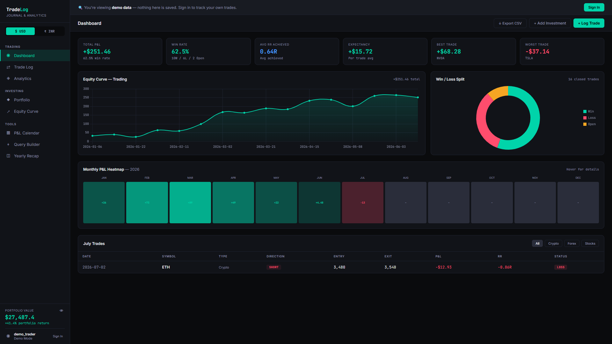
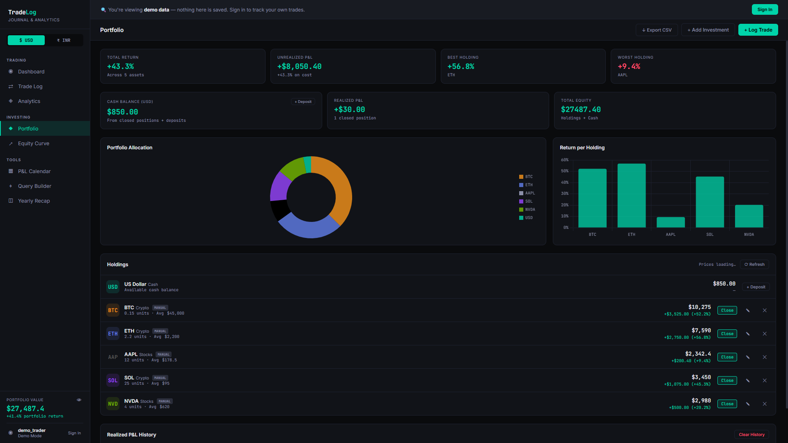

# TradeLog

A single-page trading journal and portfolio tracker for crypto, forex, and stock trades — built on Supabase (auth + Postgres + Row Level Security) with live crypto pricing via CoinGecko and optional Bybit sync. No framework, no build tooling beyond a small config-generation step, deployable to Vercel in minutes — and every service it uses runs on a free tier.

The [live deployment](https://trade-log-deploy.vercel.app) drops you straight into a fully-populated demo — no signup wall, no empty states.

## Screenshots




## Table of Contents

- [Screenshots](#screenshots)
- [Features](#features)
- [Tech Stack](#tech-stack)
- [Architecture](#architecture)
- [Project Structure](#project-structure)
- [Getting Started](#getting-started)
- [Database Schema](#database-schema)
- [Integrations](#integrations)
- [Security](#security)
- [Testing](#testing)
- [Known Limitations](#known-limitations)
- [License](#license)

## Features

**Demo Mode**
- Anyone landing on the app with no saved session gets a fully-populated demo instead of a bare sign-in wall — 18 fixed sample trades spanning Crypto/Forex/Stocks (62.5% win rate, mixed wins/losses/open positions, including a partly-closed trade), 5 sample holdings, cash and trading balances, funds history, goals and months of net-worth history, all computed with the exact same P&L/R:R formulas the real app uses, not hand-typed numbers
- Every read works normally — open any modal, browse every page, poke at the analytics — but every write (save, delete, deposit, close a position) is caught by a single `demoGuard()` check that surfaces a clear "sign in to save your own" prompt instead of silently failing or doing nothing
- Signing in or creating an account cleanly replaces the demo state with real data loaded from Supabase; a "← Back to demo" link lets someone back out of the sign-in screen without losing their place

**Trade Log**
- Entry/exit price, size, SL/TP, R:R, setup tags, and free-text notes
- Auto-computed P&L and win/loss status (generated columns in Postgres — never drifts from source data)
- **Breakeven trades get their own category** — a trade whose net P&L rounds to $0.00 is `status = 'Breakeven'`, not lumped into Loss. Win rate is calculated only over decided trades (excludes breakeven from both sides of the ratio, since a scratch isn't a win/loss outcome), while total P&L and trading balance still count breakeven trades normally — it's a display distinction, not an exclusion. A period with only breakeven trades shows win rate as "—", not a misleading 0%
- **R:R is "achieved," not "planned"** — computed from your actual exit vs. your stop-loss distance, after fees, not your take-profit target. A 3:1 setup you exit early at breakeven honestly shows `0.00R`, not `3.00R`
- **Partial closes stay one trade** — close part of a position (e.g. $50 of $100) and it stays a single Open trade showing "50% closed", left out of every stat. Closing the rest — from "Close rest" or by typing an exit in the Edit form — sets the exit to the size-weighted average of every close and counts the whole trade once. Bybit-synced partial closes work the same way. The Trade Log shows **Closed Positions** (fully closed only) next to **Closed Trades** (also includes what partial closes have realized so far)
- **Fees and net P&L** — record fees per trade (or per partial close); every stat, Win/Loss and the trading balance use net P&L. Bybit sync fills fees in from the exchange's own P&L
- **Default trading fees** — set your exchange's buy and sell fee % once in Settings and they fill in on every trade you log or close by hand, direction-aware (a Long buys on entry and sells on exit, a Short the other way round; the entry fee on the position size, the exit fee on its value at exit). You can still edit any fee, changing the rates only affects trades logged from then on, and Bybit trades always keep the fees Bybit actually charged. Buy fees, sell fees and fees as a share of gross profit show on the Trade Log and Insights pages
- **Journaling** — open/close times, emotion, "followed my plan?" and mistake tags on every trade
- **Trade detail panel** — click a symbol for everything about a trade: fills timeline, fees, planned vs achieved R:R, holding time
- **Live open P&L** — unrealized P&L on open crypto trades from the same live prices as holdings
- **Position size calculator** — balance + risk % + stop → size, quantity, leverage, planned R:R; one click to log it
- **Bybit sync** — a Sync button, plus auto-sync while the app is open: on open, when you come back to the tab, and every 3 minutes (switch off in Settings)
- Search, filters (asset, direction, setup, tag, source), sortable columns and pages; a global date range (today / 7d / month / YTD / custom…) for stats, charts and the log
- **Dates are your local day, everywhere** — a trade closed at 00:30 IST lands on that day's calendar, not on the previous UTC day; trades are ordered by their actual close time
- CSV export, and CSV import from any exchange or spreadsheet with automatic column matching and duplicate skipping — re-importing your own export keeps every timestamp exact and adds no duplicates, and "Retry" after a failed import only sends what didn't go in
- Tiny prices (PEPE, SHIB) are stored with 12 decimals and shown in full, instead of rounding to "0"
- **Trading balance** worked out from your history — deposits, withdrawals and transfers plus the net P&L of every fully closed trade — so closing a trade at +$1 raises it by $1, a −$0.50 loss lowers it, and editing, deleting, importing or syncing a trade can never leave it out of step
- **Funds history** — deposits, withdrawals (to a bank account, or cash simply removed), balance adjustments and transfers between Trading and Investing, each recorded with date and note; delete any one to reverse it (with Undo)

**Portfolio / Investing**
- Buy/sell tracking with live crypto prices (CoinGecko) — applied to crypto holdings only, so a stock that shares a ticker with a coin is never valued at the coin's price
- **Cash balance** worked out the same way — deposits and withdrawals, minus what your holdings cost, plus gains from sales — so a buy debits it, a sale credits it, and editing or deleting either is reflected automatically. Total equity (cash + holdings) always reconciles
- Cash balance shows up as its own row in the holdings list (and its own slice in the portfolio allocation chart) — a true picture of the portfolio instead of a disconnected number floating outside it
- **Buy more** of a holding (quantity added, buy price re-averaged) instead of duplicate holdings
- Full or partial position closing with realized P&L history — the sale type follows the quantity you enter, so a "Full" close can never remove more than you sold — and **Undo** for a sale entered by mistake
- **Portfolio value history** chart from a daily snapshot, kept current through the day
- Everything lives in Supabase, not just the browser — the same balances on every device, with nothing stored that could drift

Note the two balances track different things by design: **cash balance** is a buy/sell ledger (debits on purchase, credits on sale), while **trading balance** is a running equity figure driven by realized trade P&L plus manual deposits — it never gets debited by "buying" anything, since a trade isn't a purchase of an asset you hold.

**Net Worth**
- One page for everything you own across both accounts: total net worth, where it sits (trading balance, realized partial closes, open P&L, cash, holdings), realized vs unrealized gains per account, and money put in vs gains
- A bridge chart from money put in to net worth, net worth over time, and today's change — also on an Overview card and in the sidebar
- The numbers always reconcile: net worth = money put in + gains, and deposits, withdrawals, transfers, buys and sales each move exactly the parts they should

**Interface**
- Overview page led by one hero number (net P&L for the period, vs the previous period) with KPI tiles that carry running sparklines and change badges, plus a Daily P&L chart, open positions and recent trades
- Pages: **Insights** (performance by any dimension, weekday × hour heatmap, mistake cost, discipline, holding time vs result, sessions), **Risk** (drawdown chart, rolling 20-trade win rate & expectancy, R-multiple distribution, open exposure and risk to stops), **Net Worth**, **Money** (balances, cash-flow chart, net deposits, full funds history), **Equity**, **Yearly Recap**, **P&L Calendar**, **Query Builder** and a full **Settings** page
- Command palette (**Ctrl/⌘ K**) for pages, actions and trades; keyboard shortcuts (**?** lists them, **G** then a letter to jump); collapsible sidebar; URL per page (back button works)
- Every chart can flip to a data table; hover tooltips on heat cells; empty states that tell you what to do next

**Analytics & Tools**
- Equity curve, win/loss split, R:R distribution, win rate by asset
- Monthly P&L heatmap, correctly scoped to a single year — hovering shows exact figures, small accounts get 2-decimal precision instead of rounding to an indistinguishable "$0"
- **Yearly Recap** — pick any year from a dropdown (auto-populated from your actual trade history) and see win rate, total P&L, avg R:R achieved, expectancy, and best/worst trade for that year in isolation, reusing the exact same stats engine as the main dashboard so the numbers can't drift out of sync
- **P&L Calendar** with a year activity heatmap, month grid and a running daily log — a day shows exactly the trades that closed on it; partial closes are noted on their day and counted when the trade fully closes; clicking a log row jumps to that day; a mistyped future date is flagged rather than hidden
- Visual query builder with live SQL preview — results refresh when your trades change
- **Performance by** setup, tag, symbol, mistake, emotion, plan, weekday, hour, session, holding time
- **Advanced metrics** — Sharpe, Sortino, payoff ratio, recovery factor, Kelly %, expectancy in R, holding time of winners vs losers, Long vs Short, fees paid (buy / sell) and fees vs gross P&L
- **Max drawdown measured on the real account** — a date range starts from what the account actually held at that point (deposits plus every earlier trade), so a YTD dip is shown against the real balance, and Overview, Risk and Insights all report the same figure
- **Goals & limits** — monthly profit target and a daily loss limit with a warning banner when it's hit. "Today" counts each partial close on the day it happened, once
- **Account balance curve** with deposit/withdrawal markers, money put in vs taken out, and return on capital
- **Monthly report** — printable / save-as-PDF summary of any month

**Account**
- Email/password auth via Supabase, with automatic token refresh (no re-login mid-session) and clear error messages on failure — a bad request never just hangs on "Signing in…" with no feedback, and an expired session takes you back to sign-in with a plain explanation
- Editable profile with a globally unique, case-insensitive display name — live "available / taken" check as you type, enforced by a database constraint (not just client-side validation)
- USD / INR currency toggle using the live ECB rate (free, no key), hide-balance privacy toggle
- Forgot-password flow, profile photo synced across devices, full JSON backup of all your data (every row, never a partial file)
- In-app confirm dialogs and Undo after deleting a trade, holding or funds movement
- Signing out clears everything account-specific — balances, photo, prices, the screen itself — so the next person on the same browser starts clean

## Tech Stack

- **Frontend:** Vanilla HTML/CSS/JS — no framework, no bundler
- **Charts:** [Chart.js](https://www.chartjs.org/)
- **Backend:** [Supabase](https://supabase.com) (Postgres + Auth + PostgREST, accessed directly via `fetch`, no client SDK)
- **Prices:** [CoinGecko API](https://www.coingecko.com/en/api) for crypto, [Frankfurter](https://frankfurter.dev) (ECB rates) for USD/INR
- **Hosting:** [Vercel](https://vercel.com), static output with a one-step build plus serverless functions for Bybit
- **Cost:** all of the above on free tiers — Supabase Free, Vercel Hobby, CoinGecko Demo key (optional), Frankfurter (no key)

## Architecture

**Config generation, not hardcoded keys.** `public/js/config.js` (which holds live API keys) is gitignored and never committed. On Vercel, `scripts/build.js` runs as the build command and generates it from environment variables at deploy time. Locally, you copy `config.example.js` → `config.js` by hand. Either way, the Supabase URL is normalized (stripped of any accidental trailing path) before it's written, so a copy-paste mistake in the URL can't silently break auth.

**Strict CSP, no inline scripts.** `vercel.json` sets a locked-down `Content-Security-Policy` (`script-src 'self'` plus the Chart.js CDN — no `unsafe-inline`, no `unsafe-eval`). Every interactive element uses `data-action="..."` attributes routed through a single set of delegated `click`/`change`/`input`/`keydown` listeners (`js/core/events.js`), instead of inline `onclick` handlers — so the CSP stays strict without sacrificing functionality. Feature and page files register their handlers in shared tables (`ACTIONS`, `CHANGE_HANDLERS`, … in `js/core/ui.js`).

**Pages are modules; only the visible one renders.** Each page is `public/pages/<id>.html` + `public/js/pages/<id>.js`, which calls `registerPage('<id>', { title, icon, section, render })`. The router builds the sidebar and command palette from that registry, loads the page/modal HTML at start-up, and gives every page a URL (`#/risk`). Only the page on screen renders: data changes and the 60-second price refresh redraw just that page, and leaving a page releases its charts — so adding pages doesn't slow the app down. Adding a page = two new files, nothing else to edit. The partial loader works on Vercel's clean URLs and on any plain static server (VS Code Live Server, `python -m http.server`) alike.

**Charts follow one validated system.** `js/core/charts.js` themes every chart the same way (hairline grid, ≤ 24px bars with a rounded data end, 2px lines, value-first tooltips, legends only for 2+ series) and offers builders (`lineChart`, `barChart`, `donutChart`, `scatterChart`, `histogram`…). The profit/loss and categorical colors were checked with a colorblind/contrast validator against the actual card background, and every chart card can switch to a table view of its data.

**Balances are worked out, never stored.** Both balances are calculated from the history every time it changes (`js/core/balances.js`): trading = funds movements + net P&L of fully closed trades; investing cash = funds movements − what the holdings cost + realized sale gains. There's no stored number to nudge, so it can't drift: a laptop and a phone can't overwrite each other, a Bybit sync (on any device, or two at once) can't count P&L twice, and a failed save can't leave a balance half-changed. Money from before the funds history existed is carried over once as a visible "Opening balance" adjustment by the database update — so moving to this design changed no one's balance. Changes that shouldn't move a balance (trades imported from another account, a cleared sale history) are recorded as adjustments too, so the history always explains the number.

**One stats engine, one notion of time.** Every page reads from the same `computeStats()` and the same close-order (`closeSortKey`: the local calendar day plus the local close time), so the calendar, the daily P&L chart, the equity curve, streaks and drawdown all agree on which day a trade belongs to and in what order trades closed. Reads page past Supabase's 1,000-row response cap, so a long history is never silently cut off.

**Security enforced at the database, not just the client.** Every table has Row Level Security scoped to `auth.uid()`. The display-name uniqueness check is a `SECURITY DEFINER` Postgres function that returns only `true`/`false` — the client never gets read access to any other user's row, and the actual uniqueness guarantee comes from a database constraint, not client-side validation.

**Demo mode is entirely client-side.** The fixed demo dataset lives in a JS constant, built once at load time using the same P&L/status/R:R formulas as the real trade lifecycle — it never touches Supabase, so anonymous visitors can't generate load or cost against the database. Every mutating function checks a single `demoGuard()` gate before doing anything, so adding a new write path can't accidentally bypass it by forgetting a separate check somewhere else.

**Migrations are detected, not assumed.** The app checks at sign-in whether the latest database migration has run (`DB_READY`). If it hasn't, it keeps working with the older schema and shows a "Database update needed" banner instead of failing on missing columns.

## Project Structure

```
tradelog/
├── public/                  # Deployable static site (Vercel root)
│   ├── index.html           # App shell only: sign-in, sidebar, top bar, banners
│   ├── pages/               # One HTML file per page (dashboard, trades, analytics, insights, risk, networth, …)
│   ├── partials/modals/     # One HTML file per dialog (trade, close-trade, funds, import, …)
│   ├── css/
│   │   ├── tokens.css       # Design tokens: colors (incl. validated chart palette), type, spacing
│   │   ├── base.css         # Reset, focus rings, utilities
│   │   ├── layout.css       # Shell, sidebar (collapsible), top bar, grids, responsive
│   │   ├── components.css   # Buttons, forms, tiles, tables, modals, toasts, menus, command palette
│   │   ├── charts.css       # Chart cards, table view, heatmaps, legends
│   │   ├── pages.css        # Page-specific styles
│   │   └── print.css        # Monthly report print layout
│   └── js/
│       ├── config.js        # Generated at build time — gitignored, never committed
│       ├── config.example.js
│       ├── core/            # State, auth, Supabase API, data loading, prices, stats, chart engine,
│       │                    # router (page registry, lazy rendering, #/routes), UI components, start-up
│       ├── features/        # Things you can do: trade form, funds, net worth, Bybit sync, import/export,
│       │                    # report, backup, calculator, command palette, shortcuts, goals…
│       └── pages/           # One file per page — registerPage('<id>', { title, icon, render })
├── api/                     # Vercel serverless functions (server-only, never shipped to the browser)
│   ├── _bybit-shared.js     # Shared Bybit sync logic (underscore = not its own route, see file header)
│   ├── bybit-sync.js        # Sync button + in-app auto-sync — user session auth, respects RLS
│   └── bybit-cron.js        # Optional sync while the app is closed — service_role auth, see docs/BYBIT_INTEGRATION.md
├── scripts/
│   └── build.js             # Generates config.js from env vars; runs automatically on Vercel
├── sql/
│   ├── schema.sql           # Full Supabase schema for a fresh install (also shown in the app's Schema page)
│   └── migrations/          # Run these in date order on an existing database
├── tests/                   # `npm test` (Bybit sync engine), `npm run test:e2e` (whole app in headless Chrome), `npm run test:sql` (schema + migration on real Postgres)
├── docs/
│   ├── SETUP.md             # Step-by-step setup + troubleshooting guide
│   ├── BYBIT_INTEGRATION.md # Bybit sync architecture, setup, and security tradeoffs
│   └── examples/            # Optional GitHub Actions schedule for bybit-cron.js (inactive until copied to .github/)
├── OUTSIDE_CODE_TODO.md     # Steps to do in Supabase / Vercel / by hand — kept up to date
├── GITHUB_UPLOAD.md         # Which files go to GitHub, which never do, and how to upload
├── screenshots/             # README images
├── package.json
├── vercel.json               # Build command, output dir, security headers (CSP, HSTS, etc.)
├── .gitignore
└── README.md
```

## Getting Started

For full step-by-step instructions (including Supabase project creation and troubleshooting), see **[docs/SETUP.md](docs/SETUP.md)**. Quick version:

### 1. Set up Supabase

1. Create a project at [supabase.com](https://supabase.com).
2. Open **SQL Editor** and run the full contents of `sql/schema.sql`. This creates every table (`trades`, `investments`, `profiles`, `user_settings`, `fund_transactions`, `realized_positions`, `portfolio_snapshots`), their indexes, RLS policies, and the display-name availability function.
   - **Already have an older TradeLog database?** Download a backup from the app first (Settings → Your data), then run the files in `sql/migrations/` instead, in date order (`2026-10-25-…`, `2026-10-26-…`, `2026-10-27-…`). Each one is safe to run more than once, and nothing in your data is lost — your current balances are carried over as "Opening balance" entries in the funds history.
3. Go to **Settings → API** and copy your **Project URL** (bare origin, e.g. `https://xxxxx.supabase.co` — no `/rest/v1` or other path suffix) and **anon public key**.
4. For "Forgot password?" links: **Authentication → URL Configuration** → set the **Site URL** to your live site and add it (plus `http://localhost:3000`) to **Redirect URLs**.

### 2. (Optional) Set up CoinGecko

Create a free account at [coingecko.com/en/api/pricing](https://www.coingecko.com/en/api/pricing) and grab a **Demo API key** for live crypto prices. The app works without one, at a lower rate limit.

### 3. Local development

```bash
cp public/js/config.example.js public/js/config.js
```

Fill in your keys in `public/js/config.js`, then:

```bash
npm run dev
```

Opens at `http://localhost:3000`. `config.js` is gitignored — it will never be committed. Any static server works too (e.g. VS Code Live Server); opening `index.html` straight from disk (`file://`) doesn't, and the app tells you so. To try Bybit sync locally, use `npx vercel dev`, which also runs the `api/` functions.

### 4. Deploy to Vercel

1. Push this repo to GitHub.
2. Import it into Vercel.
3. In **Project → Settings → Environment Variables**, add:
   - `SUPABASE_URL`
   - `SUPABASE_ANON_KEY`
   - `COINGECKO_API_KEY` (optional)
   - For Bybit sync (optional): `BYBIT_API_KEY`, `BYBIT_API_SECRET` (read-only key) and `TRADELOG_SYNC_USER_ID` — your own Supabase user id (Authentication → Users), the only account allowed to sync
4. Deploy. Vercel runs `node scripts/build.js` automatically (configured in `vercel.json`), which generates `config.js` from those env vars at build time — the file itself never touches your git history.

## Database Schema

| Table | Purpose | Key constraint |
|---|---|---|
| `trades` | Trade log entries, incl. fees (total + buy / sell split), journaling fields and partial-close fills (`closes`) | `pnl`, `net_pnl` and `status` are Postgres generated columns — always derived, never stale |
| `investments` | Portfolio holdings | — |
| `realized_positions` | Investment sales (realized P&L history) | One row per sale, so a sale can be undone |
| `fund_transactions` | Deposits, withdrawals, adjustments (incl. carried-over opening balances), transfers | Signed amounts; a transfer is two rows sharing a `transfer_id` |
| `portfolio_snapshots` | Daily portfolio value for the history charts | One row per user per day |
| `user_settings` | Preferences (goals, limits, fee rates, auto-sync) | One row per user; `ledger_balances` = balances are worked out from the history (the old stored balance columns are kept, unused) |
| `profiles` | Display name + profile photo | Case-insensitive **unique index** on `display_name` |

All tables have Row Level Security enabled, scoped to `auth.uid() = user_id`. Prices are stored with 12 decimals. Full definitions, indexes, and the `is_display_name_available()` function are in `sql/schema.sql`.

## Integrations

**Bybit derivatives sync** — opt-in, not enabled on the live demo. Every Bybit derivatives position — opened, partly closed, or closed — flows into the Trade Log instead of being logged by hand.

Both paths run as Vercel serverless functions so the API secret never reaches the browser:
- **Sync button + auto-sync while the app is open** (`api/bybit-sync.js`) — authenticates as your own session and respects Row Level Security like every other request. It only syncs for the account set in `TRADELOG_SYNC_USER_ID`, since the server's Bybit key belongs to one person, and it reports the exact P&L it wrote so the trading balance moves once and only once.
- **Optional sync while the app is closed** (`api/bybit-cron.js`) — needs a Supabase `service_role` key, which bypasses RLS entirely; documented with that tradeoff stated plainly rather than glossed over, plus a free GitHub Actions workflow (`docs/examples/github-actions-bybit-sync.yml` — copy it to `.github/workflows/` to turn it on) for frequent polling without needing Vercel's paid per-minute cron tier.

Both share one matching engine (`api/_bybit-shared.js`) that correctly updates an "Open" trade into a "Closed" one in place rather than creating a duplicate row, keeps partial closes on the same trade, takes fees from the exchange's own P&L, dates trades by your local day, and is idempotent — re-syncing changes nothing. Full guide, including known edge cases and the "why not real-time WebSocket push" tradeoff: **[docs/BYBIT_INTEGRATION.md](docs/BYBIT_INTEGRATION.md)**.

## Security

- **Row Level Security everywhere.** Every table restricts reads and writes to the authenticated user's own rows. This holds even if client-side code is tampered with (e.g. via browser DevTools) — Postgres checks `auth.uid()` from the JWT server-side, not anything sent in the request body.
- **Strict CSP.** No inline scripts, no `unsafe-eval`. Combined with `X-Frame-Options: DENY`, `X-Content-Type-Options: nosniff`, and HSTS (see `vercel.json`).
- **Pinned third-party code.** Chart.js loads with a Subresource Integrity hash — the browser refuses the file if the CDN ever serves anything else.
- **The Supabase anon key is safe to expose client-side** — it carries no special privileges on its own; RLS is what actually protects data.
- **Narrow-scope RPC for uniqueness checks.** `is_display_name_available()` runs as `SECURITY DEFINER` (so it can see across all users despite RLS) but returns only a boolean — never row data — keeping the privilege escalation as narrow as possible.
- **Bybit sync is locked to its owner.** A valid login alone isn't enough: the sync endpoint only acts for the user id in `TRADELOG_SYNC_USER_ID`, so nobody who signs up can pull the owner's exchange history into their own account.
- **XSS-safe rendering.** All user-supplied text (trade notes, symbols, display names, etc.) is HTML-escaped before being inserted into the DOM.

## Testing

- `npm test` — the Bybit sync engine against an in-memory Bybit + Supabase: open → partial → full close, scale-ins, orphaned rows, re-syncs and timezone dates.
- `npm run test:e2e` — the whole app in headless Chrome or Edge (nothing to install) against a fake Supabase: every page in demo mode, funds, trades and fees, partial closes, Undo, investing, net worth accounting, the P&L calendar and daily chart, balances worked out from the history (two devices, trades synced elsewhere, imports kept out of the balance), loading past 1,000 rows, default trading fees, CSV import, backups, password reset — plus a run against the pre-migration schema, where balances are still stored.
- `npm run test:sql` — `sql/schema.sql` and the latest migration on a real Postgres ([PGlite](https://pglite.dev), runs in-process after `npm install`): the carried-over opening balances, re-runs, rebuilt generated columns and 12-decimal prices.

## Known Limitations

- Single-user-per-account personal tool — there's no team/sharing model, and Bybit sync serves one account.
- Currency toggle covers USD/INR display only; all figures are stored in a single base currency internally.
- Live prices cover crypto only; stocks and other holdings use the price you enter.
- Portfolio history is recorded from the browser, so days the app wasn't opened have no point (the line just connects).
- Bybit sync runs while the app is open (or on demand); the optional cron covers the app being closed.

## License

Personal project — not licensed for redistribution.
